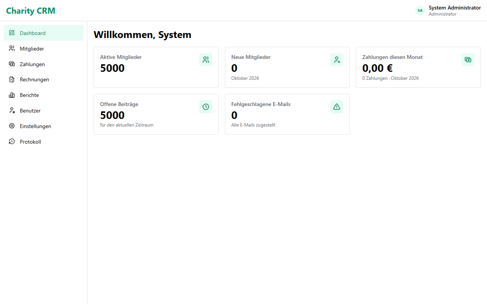
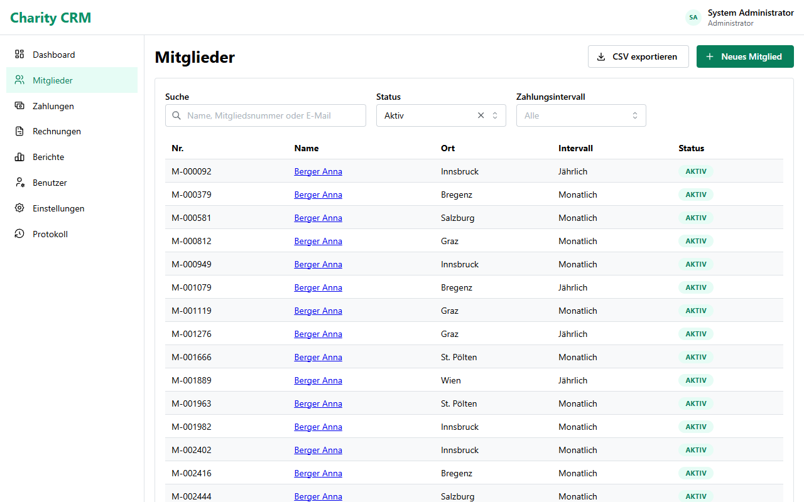
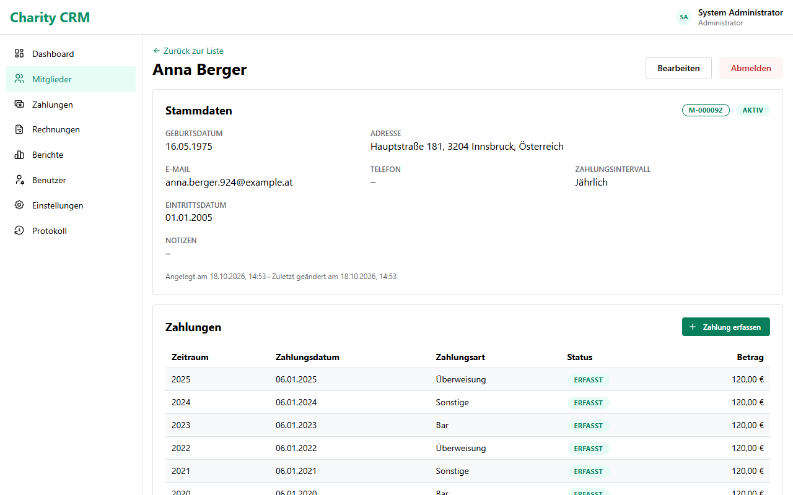
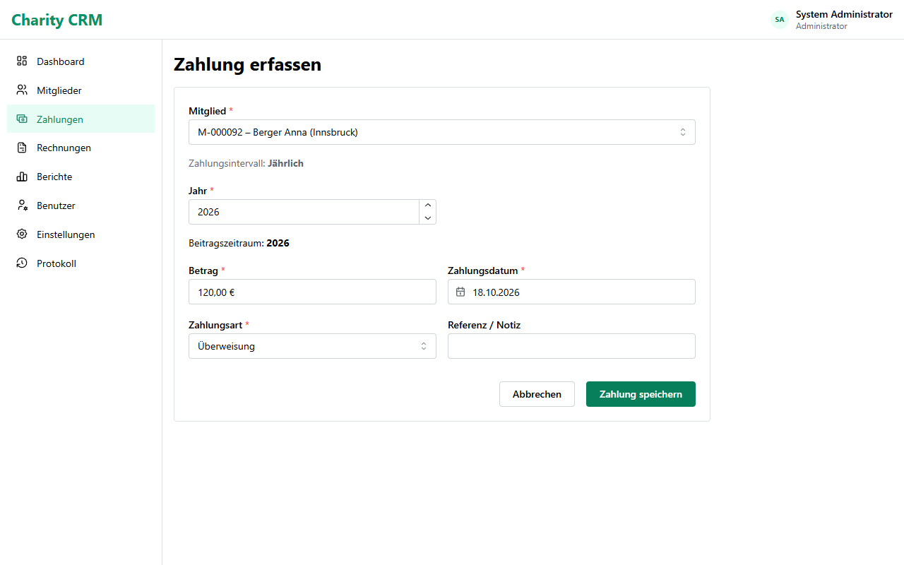
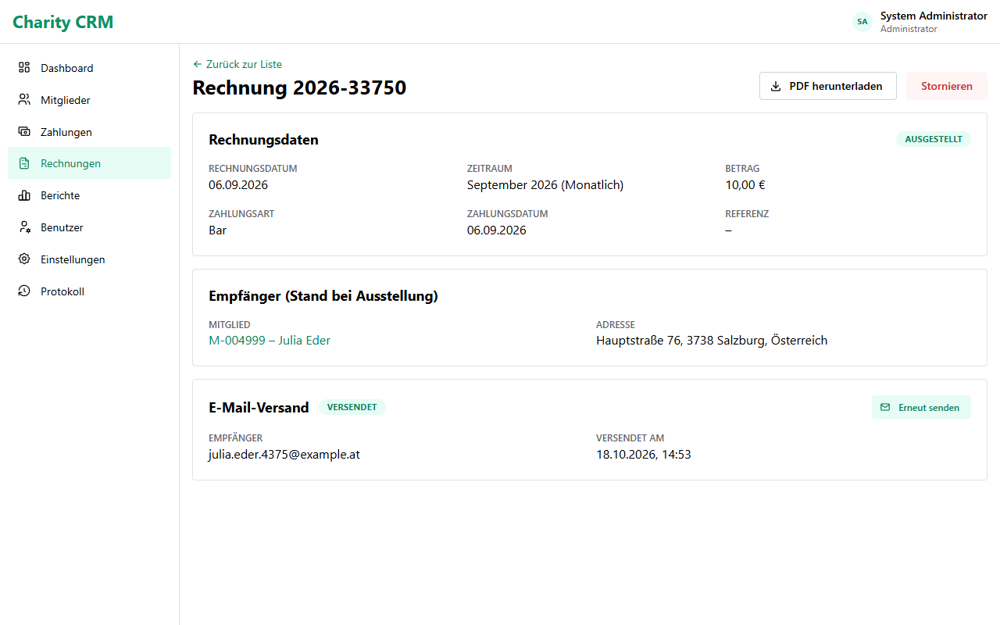
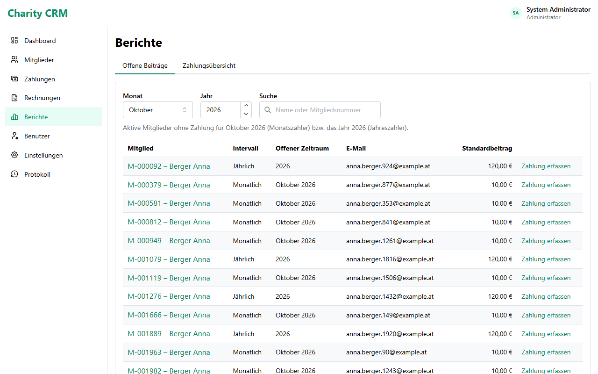
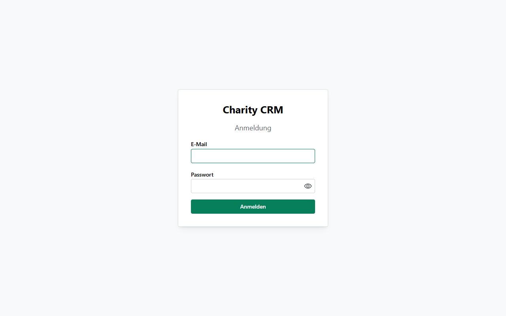

# Charity CRM App

Membership-fee management for a charity organization. Staff manage member records, record monthly or yearly
membership contributions, and the system generates PDF invoices and emails them to members — all within a
role-based access system.

> Learning / portfolio project. Not intended for commercial use.



## Documentation

| Document | Description |
|---|---|
| [Requirements](docs/REQUIREMENTS.md) | Functional requirements, roles, permission matrix, acceptance criteria |
| [Non-Functional Requirements](docs/NON_FUNCTIONAL_REQUIREMENTS.md) | Security, performance, reliability, operations |
| [Architecture](docs/ARCHITECTURE.md) | Tech stack, containers, data model, API, flows, Docker setup |
| [Roadmap](docs/ROADMAP.md) | Phased development plan with task checklists |
| [CLAUDE.md](CLAUDE.md) | Working instructions for Claude Code |

## Quick start

Requirements: Docker (with Docker Compose v2).

```bash
cp .env.example .env     # set POSTGRES_PASSWORD and SEED_ADMIN_PASSWORD
docker compose up --build
```

| Service | URL |
|---|---|
| Web app | http://localhost:8080 |
| Mailpit (captured emails) | http://localhost:8025 |

Log in with `SEED_ADMIN_EMAIL` / `SEED_ADMIN_PASSWORD` from `.env`. You will be asked to change the password on
first login. The admin is only created when the database contains no users yet.

Then, as admin:

1. **Einstellungen** – enter the organization data (shown on invoices) and the default monthly/yearly fees.
2. **Benutzer** – create users for cashiers and secretaries (they get a temporary password and must change it).
3. **Mitglieder** → **Zahlungen** – register members and record payments; each payment creates an invoice PDF
   that is emailed automatically if the member has an email address (see Mailpit).

## Roles

Every user has exactly one role. Authorization is enforced by the API; the UI only hides what a role cannot use.

| Capability | Administrator | Kassier (Cashier) | Schriftführer (Secretary) |
|---|:-:|:-:|:-:|
| Users, organization & fee settings, audit log | ✅ | – | – |
| View members | ✅ | ✅ (read-only) | ✅ |
| Create / edit / de-register members, CSV export | ✅ | – | ✅ |
| Record payments, invoices (view, download, cancel, resend) | ✅ | ✅ | – |
| Reports (open contributions, payment summary) | ✅ | ✅ | – |
| Dashboard | ✅ (all figures) | ✅ (all figures) | ✅ (member figures only) |

The full matrix is in [REQUIREMENTS §3](docs/REQUIREMENTS.md#3-roles--permission-matrix).

## Screenshots

| | |
|---|---|
|  |  |
| Member list with search and filters | Member details with payments and invoices |
|  |  |
| Recording a payment (period and amount prefilled) | Invoice with PDF download, cancellation and email status |
|  |  |
| Open contributions report | Login |

## Email

By default all emails go to **Mailpit**, which captures them without delivering anything; open
http://localhost:8025 to see them. Emails are sent by a background worker (outbox pattern): an SMTP outage never
affects recording payments, failed sends are retried up to 5 times with increasing delay, and the invoice shows
the email status. Invoices can be resent manually, optionally to a different address.

### Switching to a real SMTP provider

Only `.env` changes are needed (e.g. Brevo, Mailjet, your mail host):

```dotenv
SMTP_HOST=smtp-relay.example.com
SMTP_PORT=587
SMTP_USERNAME=your-smtp-user
SMTP_PASSWORD=your-smtp-password
SMTP_USE_STARTTLS=true
SMTP_FROM_ADDRESS=verified-sender@yourdomain.at
SMTP_FROM_NAME=Mein Verein
```

Then restart: `docker compose up -d`. The sender address must be verified with the provider.
When the app is served over HTTPS, also set `AUTH_COOKIE_SECURE=true`.

## Backup and restore

The database and the `appdata` volume (invoice PDFs and the session encryption keys) are backed up together:

```bash
scripts/backup.sh                     # writes backups/db-<timestamp>.dump and backups/appdata-<timestamp>.tar.gz
scripts/restore.sh backups/db-<ts>.dump backups/appdata-<ts>.tar.gz   # asks for confirmation, replaces all data
```

Both scripts use the Compose project `charity-crm`; set `COMPOSE_PROJECT_NAME` for another one. They run on
Linux/macOS and in Git Bash on Windows.

## Development

```bash
# Backend (.NET 10 SDK) – needs a local PostgreSQL for `dotnet run`, Docker for the integration tests
cd backend
dotnet build
dotnet test                       # unit tests + integration tests (Testcontainers starts PostgreSQL)
dotnet run --project src/CharityCrm.Api    # http://localhost:5001, Scalar API docs at /scalar
dotnet ef migrations add <Name> -p src/CharityCrm.Infrastructure -s src/CharityCrm.Api -o Persistence/Migrations

# Frontend (Node 22+)
cd frontend
npm install
npm run dev                       # http://localhost:5173, proxies /api to :5001
npm test
npm run lint
```

Migrations are applied automatically when the API starts.

### Demo data / performance check

On a database **without members**, the API can generate 5,000 members with 100,000 payments and invoices:

```bash
docker compose run --rm api seed-demo 5000 100000
```

With that data all list and search endpoints answered in well under 500 ms (p95, measured through nginx) and
generating an invoice PDF took about 0.2 s.

## Tech stack

.NET 10 · ASP.NET Core Minimal APIs · ASP.NET Core Identity · EF Core · PostgreSQL 17 · React + TypeScript (Vite) ·
React Router · TanStack Query · Mantine · react-hook-form + zod · QuestPDF · MailKit · Serilog · nginx · Mailpit ·
Docker Compose

Tests: xUnit, FluentAssertions, Testcontainers, WebApplicationFactory; Vitest.
